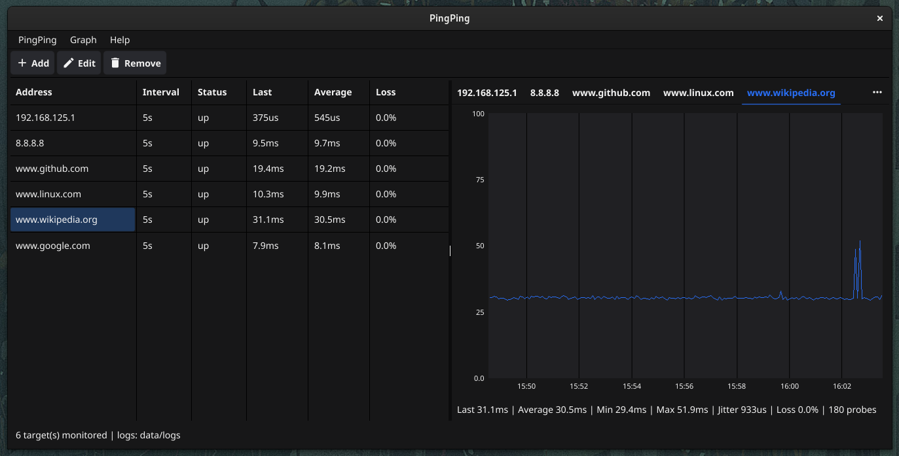

# PingPing


A portable network monitoring tool. PingPing pings the addresses you configure,
shows the round trip time in real time, keeps a daily rotated log of every probe
and stays in the system tray while it monitors.

## Features

- Monitor any number of addresses, host names included.
- Per target ping interval and timeout.
- Real time round trip time graph, the visible window is configurable and
  defaults to one hour.
- Statistics per target: last, average, minimum, maximum, jitter and packet
  loss.
- Persistent daily rotated CSV logs with a configurable retention.
- Minimises to the system tray, the monitoring keeps running when the window is
  closed.
- Single portable binary, nothing to install.
- Linux, Windows and macOS.

## Screenshots

The main window shows the list of the monitored targets on the left and the
graph of the selected target on the right.



## Installation

PingPing is portable: download the archive of your platform, unpack it and
run the binary. There is no installer and no system wide configuration.

The program stores its configuration in the user configuration directory and
its logs in the user data directory of the operating system:

| Platform | Configuration | Logs |
| -------- | ------------- | ---- |
| Linux | `$XDG_CONFIG_HOME/pingping/config.json` (`~/.config/...`) | `$XDG_DATA_HOME/pingping/logs` (`~/.local/share/...`) |
| macOS | `~/Library/Application Support/pingping/config.json` | `~/Library/Application Support/pingping/logs` |
| Windows | `%AppData%\pingping\config.json` | `%LocalAppData%\pingping\logs` |

A `config.json` in the folder the program is started from replaces the one of
the user configuration directory, the two setups are then independent. It
makes a portable installation possible, copy the configuration file next to
the binary and the program uses it. The path of the file in use is shown in
`PingPing -> Settings`. The `-config` flag has the priority over both of
them.

The logs stay where the configuration file says, a fully portable
installation needs a `dataDir` next to the configuration file:

```json
{
  "dataDir": "./data"
}
```

## Usage

Start the application and add the addresses you want to watch with the `Add`
button or with `PingPing -> Add target`.

The add and edit dialog takes four fields:

| Field | Description |
| ----- | ----------- |
| Address | The host name or IP address to ping. |
| Interval | The delay between two probes, for example `5s` or `1m`. |
| Timeout | The time after which a probe is reported as lost, for example `1s`. |
| Enabled | Uncheck it to keep the target but stop probing it. |

Selecting a row of the table shows the graph of that target. The summary line
below the graph holds the statistics of the visible window. The time axis uses
clock times on a round interval and slides with the graph, the grid lines are
the same ticks.

The graph window can be changed with the `Graph` menu or in the settings, the
`Settings` item of the `PingPing` menu opens them:

| Setting | Description |
| ------- | ----------- |
| Graph window | The time span shown by the graphs, from 15 minutes to 24 hours. |
| Keep logs for (days) | The number of days of logs that are kept, `0` keeps everything. |
| ICMP mode | How the ICMP sockets are opened, see below. |
| Log folder | The folder with the log files, it can be opened with a click. |

Closing the window hides it, the program keeps monitoring in the system tray.
Use the tray menu to show the window again or to quit.

The menu bar holds three menus:

| Menu | Items |
| ---- | ----- |
| `PingPing` | Add target, Open log..., Settings, Quit. |
| `Graph` | The length of the graph window, from 15 minutes to 24 hours, the current one is checked. |
| `Help` | About, it shows the icon, the name, the version and the author. |

### Open a log

`PingPing -> Open log...` (or `Ctrl+O`) opens an old CSV log in its own window.
The file dialog starts in the log folder, only shows `.csv` files and is sized
to the main window. The same window can be opened at startup with the `-log`
flag, for example:

```bash
pingping -log ~/.local/share/pingping/logs/pings-1.1.1.1-2026-10-21.csv
```

The window shows the graph of the file with a summary line. The `From` and `To`
fields take a `2026-10-21 09:00:00` time, `Apply` redraws the graph for that
range and the `Range` list offers the whole file or the last 15 minutes, hour,
6 hours and 24 hours. A file that holds more than one target, as the logs of
the older versions do, gets a `Target` list above the graph. The axis shows the
times of the file, not the current time.

### ICMP mode

| Mode | Behaviour |
| ---- | --------- |
| `auto` | Tries an unprivileged ICMP socket first and falls back to a privileged raw socket when the system refuses it. |
| `unprivileged` | Only uses the unprivileged ICMP datagram socket, needs `net.ipv4.ping_group_range` to include the user. |
| `privileged` | Always uses a raw socket, needs root or `CAP_NET_RAW`. |

On Windows the ICMP sockets need an elevated process, the `auto` mode picks the
working flavour by itself.

### Linux and unprivileged ICMP

Linux has two ways to open an ICMP socket:

| Socket | Needs | Used by |
| ------ | ----- | ------- |
| raw (`SOCK_RAW`) | the `CAP_NET_RAW` capability, so root or a file capability | the `ping` command, it ships with `cap_net_raw=ep` |
| datagram (`SOCK_DGRAM`) | the group of the user inside `net.ipv4.ping_group_range` | unprivileged programs |

The `ping` command never needs the sysctl because the binary itself carries
the privilege: on Ubuntu and Debian it has the file capability
`cap_net_raw=ep`, on older distributions it is setuid root. A plain program
like PingPing has no such privilege, so it can only use the datagram
socket, and that is what `net.ipv4.ping_group_range` controls. The default
value `1 0` means that no group at all may open one, so a normal user gets:

```
socket: permission denied: unprivileged ICMP is blocked, allow it with:
sudo sysctl -w net.ipv4.ping_group_range="0 2147483647"
```

Two ways to fix it:

```bash
# 1. allow the datagram socket for every local user, one line, no root at runtime
sudo sysctl -w net.ipv4.ping_group_range="0 2147483647"

# 2. give PingPing the same capability the ping command has
sudo setcap cap_net_raw=ep /path/to/pingping
```

Option 1 is what Debian and Ubuntu ship in
`/usr/lib/sysctl.d/iputils-ping.conf`. To make it permanent, create
`/etc/sysctl.d/99-pingping.conf` with:

```
net.ipv4.ping_group_range = 0 2147483647
```

and run `sudo sysctl --system`.

Option 2 keeps the system strict, but the file capability needs a filesystem
with extended attribute support, it is lost when the binary is replaced and
it has to be set again after every update.

To see what the system allows, run:

```bash
pingping -diagnose
```

```
pingping 0.1.1 - ICMP diagnostics

OS: linux
user: ubuntu (uid=1000, gid=1000)
net.ipv4.ping_group_range: 1 0
capabilities: none

unprivileged ICMP socket (SOCK_DGRAM): FAILED
    socket: permission denied
privileged ICMP socket (SOCK_RAW): FAILED
    listen ip4:icmp 0.0.0.0: socket: operation not permitted

How to fix it:
  the unprivileged socket needs the group of the user inside
  net.ipv4.ping_group_range:
      sudo sysctl -w net.ipv4.ping_group_range="0 2147483647"
  the privileged socket needs root or the CAP_NET_RAW capability:
      sudo setcap cap_net_raw=ep <path of the binary>
```

The same error is shown in the interface: the status column of the target
reads `error` and the line below the graph holds the reason.

### Command line

```
Usage of pingping:
  -config string
        path of the configuration file
  -data-dir string
        directory of the persistent data
  -diagnose
        report the ICMP capabilities of the system and exit
  -log string
        open a log file in a graph window at startup
  -version
        print the version and exit
```

## Logs

Every target has its own CSV file, named `pings-<address>-YYYY-MM-DD.csv`,
inside the log folder:

```
pings-1.1.1.1-2026-10-21.csv
pings-8.8.8.8-2026-10-21.csv
```

The files are rotated every 24 hours, one file per target and per day. The
characters that are not allowed in a file name are replaced, an IPv6 address
becomes `2001_db8__1` for example. Two targets with the same address share
the file, the `target_id` column tells them apart.

The content of a file is:

```csv
timestamp,target_id,address,rtt_ms,success,error
2026-10-21T09:23:51.285661599Z,a1,127.0.0.1,0.045,true,
2026-10-21T09:25:35.328929207Z,b2,10.255.255.1,0.000,false,timeout
```

The `rtt_ms` column holds the round trip time in milliseconds, a failed probe
has `success` set to `false` and the reason in the `error` column.

## Configuration file

The configuration is written when the application starts and after every
change, so it can be edited by hand as well:

```json
{
  "targets": [
    {
      "id": "a1",
      "address": "1.1.1.1",
      "interval": "5s",
      "timeout": "1s",
      "enabled": true
    }
  ],
  "graphWindow": "1h",
  "logRetentionDays": 30,
  "icmpMode": "auto",
  "dataDir": "/home/user/.local/share/pingping"
}
```

## Development

### Requirements

- Go 1.27.3 or newer.
- A C toolchain, Fyne uses cgo for the OpenGL driver.
- On Linux the OpenGL and X11 development headers, on Debian or Ubuntu:

```bash
sudo apt-get install libgl1-mesa-dev xorg-dev libglx-dev libwayland-dev \
    wayland-protocols libxkbcommon-dev librsvg2-bin
```

- ImageMagick, only to regenerate the icons from the SVG sources.

### Build

```bash
make build
```

The binary is written to `dist/pingping`. The version is taken from the git
tags, it can be overridden:

```bash
make build VERSION=0.2.0
```

### Cross compilation

The Windows executable is built from Linux with the mingw cross compiler:

```bash
sudo apt-get install gcc-mingw-w64-x86-64
make install-tools   # installs go-winres, needed for the icon and the version information

make build-windows
```

It is written to `dist/pingping.exe`. Fyne needs cgo for the graphics
libraries, so the cross compiler and `CGO_ENABLED=1` are mandatory, Go turns
cgo off by itself when the target platform differs from the host. The binary
is linked against the Windows GUI subsystem, so it does not open a console
window.

The `windows-resource` target writes the icon and the version information of
the file properties into `rsrc_windows_amd64.syso`, the Go linker embeds it
into the executable. The icon is the one of the application, resized to the
sizes Windows expects, and the manifest asks for the administrator rights,
the raw ICMP sockets of Windows need them.

The compiler can be changed with `WIN_CC`:

```bash
make build-windows WIN_CC=x86_64-w64-mingw32-gcc
```

A macOS build needs the macOS SDK, so it has to be compiled on a Mac.

### Test

```bash
make test
```

### Quality control

```bash
make install-tools   # once, installs staticcheck and govulncheck
make audit
```

`make audit` runs `go mod tidy -diff`, `go mod verify`, `gofmt`, `go vet`,
`staticcheck` and `govulncheck`.

### Icons

The window and the tray icons are generated from the SVG sources in `assets`
with ImageMagick and embedded into the binary:

```bash
make icons
```

### Packages

| Package | Responsibility |
| ------- | -------------- |
| `internal/config` | Configuration model, JSON serialisation, defaults, paths. |
| `internal/appinfo` | Name, author and version of the application, the build sets the version. |
| `internal/ping` | ICMP probing, privilege fallback, per packet timeout tracking. |
| `internal/monitor` | Target lifecycle and fan out of the samples. |
| `internal/history` | Rolling sample buffer and the statistics. |
| `internal/logstore` | Daily rotated CSV writer with retention. |
| `internal/ui` | Dashboard, target table, dialogs, settings, system tray, graph. |
| `assets/icons` | Embedded PNG icons. |

### Packaging

```bash
make deb   # Debian package in dist
make rpm   # RPM package in dist
```

### Releases

The GitHub Actions release workflow runs when a `v*` version tag is pushed. It
builds Linux and Windows assets on Linux, and macOS archives on native ARM64
and Intel runners. The Linux release target also builds the DEB and RPM
packages. Release files are staged in `dist/release/`.

The Make targets can also be run locally:

```bash
make release-linux VERSION=0.5.5   # Linux, Windows, DEB and RPM assets
make release-macos VERSION=0.5.5   # run on macOS; builds for the host architecture
make release-checksums             # checksum files already staged in dist/release
```

`release-linux` requires the Linux/Fyne development dependencies above, plus
`gcc-mingw-w64-x86-64`, `dpkg-dev`, `rpm`, `zip`, and the `go-winres` tool
(`make install-winres`). To publish through GitHub Actions, push a version
tag, for example `git push origin v0.5.5`.
